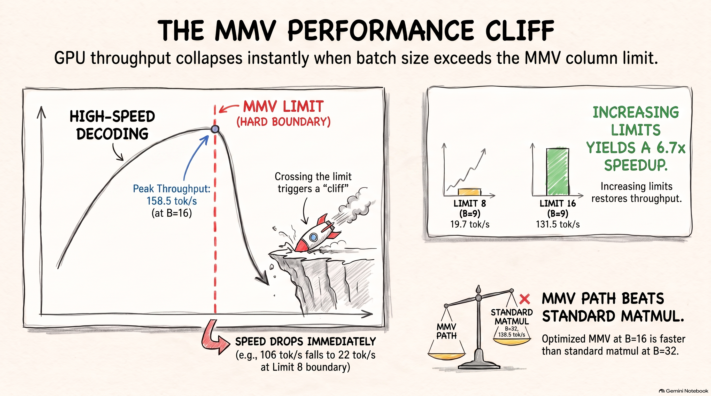
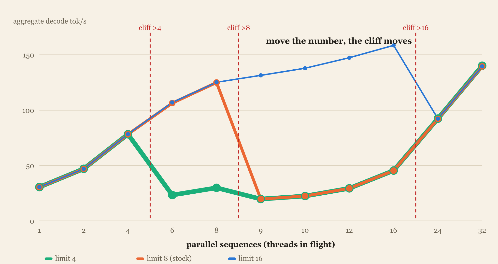
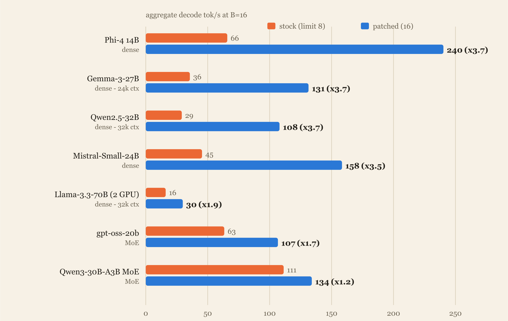
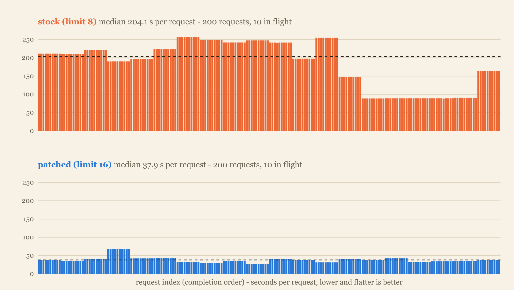
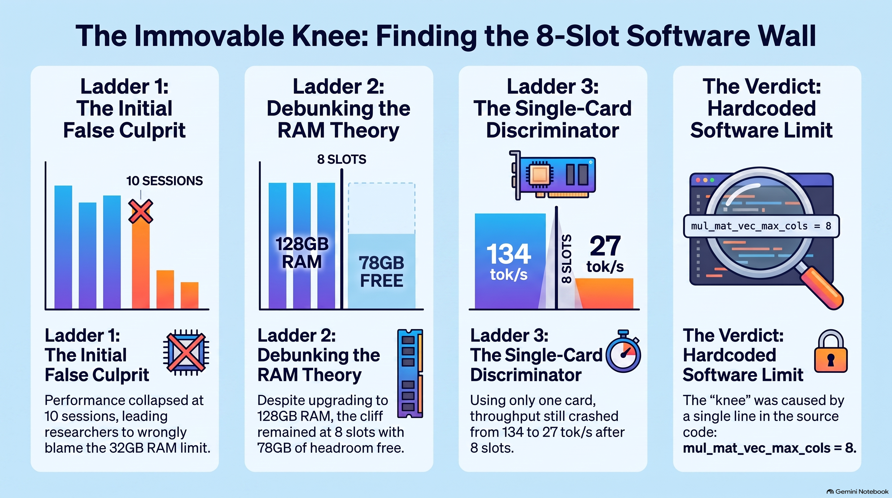
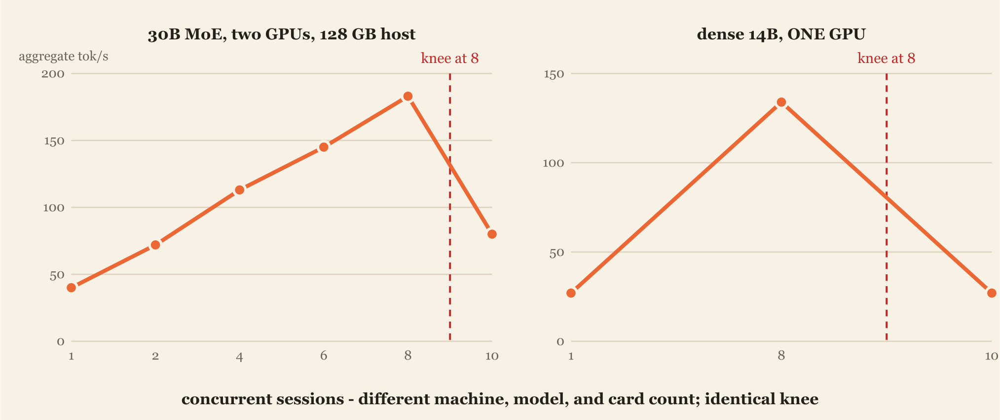
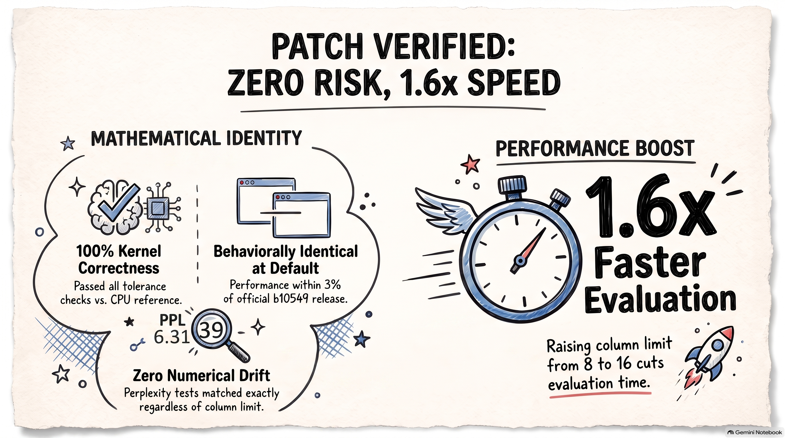

# vulkancliff

**Your local LLM server has a multitasking ceiling of exactly 8 — it's one line of
code, and moving it makes the 9th parallel request up to 6.9× faster on the same
hardware.**

```cpp
static constexpr uint32_t mul_mat_vec_max_cols = 8;
```

*(llama.cpp Vulkan backend — `ggml/src/ggml-vulkan/ggml-vulkan.cpp`, ~line 389 at
master `e85caa8`.)*

This repo is the complete evidence package: the patch, the raw benchmark data, the
harnesses that produced it, the charts, and the write-up media. Measured on
**Windows 11 + Intel Arc Pro B70 (Xe2)**; the same cliff is reported on AMD in
[llama.cpp #25356](https://github.com/ggml-org/llama.cpp/issues/25356).

[](media/The_MMV_Performance_Cliff.png)

## The finding in one chart

Decode batches of ≤8 sequences ride a fast matrix-vector kernel; the 9th falls onto
a general matmul path and aggregate throughput collapses ~6×. We patched the
constant into a runtime knob (`GGML_VK_MMV_MAX_COLS`, default 8 = byte-identical
stock, one file, +24/−3) and proved causality by dose-response — set the limit to
4 / 8 / 16 and the cliff lands at exactly 4 / 8 / 16:



*Line widths are stepped because the three runs measure **identical** values
wherever the curves share a path — wherever the thin blue core rides the orange
edge over the green halo, all three configs agreed.*

## Headline numbers

Mistral-Small-24B Q4_K_M, one Arc Pro B70, warm reps:

| measure | stock (8) | patched (16) | gain |
|---|---|---|---|
| 9th thread, aggregate decode | 19.7 tok/s | 131.5 tok/s | **×6.7** |
| 16 threads, aggregate decode | 45.4 tok/s | 158.5 tok/s | **×3.5** |
| fast path @16 vs matmul @32 | 139.5 (B=32) | 158.5 (B=16) | fast path wins |
| median request latency, 10 concurrent | 204 s | 38 s | **×5.4** |
| per-stream decode, 10 concurrent | 1.3 tok/s | 5.4 tok/s | ×4.2 |

It is not one model. Seven models people actually recognize, stock vs patched at
16 threads — every dense model gains ×3.5–3.7 at B=16 (and ×6.6–6.9 at the 9th
thread); MoE models gain only their dense-attention share, because their expert
FFNs sit behind a separate dispatch gate (`MUL_MAT_ID`):



And the experiential view — 200 requests at 10 concurrent, per-request latency as
a frame-time strip. Stock past its cliff is not "stuttery", it is uniformly
broken: every stream crawls at ~1.3 tok/s, below human reading speed:



## The video

**[The Fake Hardware Wall — Debugging a 6× AI Throughput Collapse](media/The_Fake_Hardware_Wall__Debugging_a_6x_AI_Throughput_Collapse.mp4)**
(mp4, ~65 MB — GitHub plays it in the browser). Companion deck:
[Breaking the Vulkan Ceiling (PDF)](media/Breaking_the_Vulkan_Ceiling.pdf).

## Why the wall fooled us

The knee survived a complete machine rebuild — new CPU, 4× the RAM, new OS, a
year-newer driver — because a compile-time constant is blind to all of it. The
commit-charge gauge that redlined alongside the collapse was a coincidence wearing
a causation costume:

[](media/The_8-Slot_Software_Wall.png)



## Repo map

| path | contents |
|---|---|
| [`BRIEF.md`](BRIEF.md) | the full technical brief (what/why/impact/method/results/links) |
| [`patch/GGML_VK_MMV_MAX_COLS.diff`](patch/GGML_VK_MMV_MAX_COLS.diff) | the one-file patch (env knob, default 8 = stock, clamp 1..16) |
| [`data/`](data/) | per-dataset summaries (markdown) + `expZ-summary.csv` + [`data/raw/`](data/raw/) — every batched-bench output, frame-pacing JSONL, and perplexity log |
| [`harness/`](harness/) | the PowerShell harnesses + parsers that produced the data (cool-start gated, VRAM-spill guarded) |
| [`charts/`](charts/) | SVG/PNG charts + [`gen_charts_light.py`](charts/gen_charts_light.py) (regenerates everything from `data/raw/`) |
| [`media/`](media/) | infographics, the PDF deck, the video |

## Correctness

- `test-backend-ops -o MUL_MAT` vs CPU reference with the limit at 16: **all pass**
  (exercises column counts 9–16, unreachable in stock builds).
- Patched binary at default vs stock prebuilt: ±3 % on a pp/tg sanity bench.
- Perplexity A/B, env 8 vs 16, same text: `PPL = 6.3139 +/- 0.28430` under both —
  **identical to every printed digit** (details: [`data/data-correctness.md`](data/data-correctness.md)).



## Reproduce

```
llama-batched-bench -m <model.gguf> -c 65536 -ngl 999 -fa 1 -npp 512 -ntg 128 \
  -npl 1,2,4,6,8,9,10,12,16,24,32
```

with `GGML_VK_MMV_MAX_COLS` ∈ {4, 8, 16} on a patched build (apply
`patch/GGML_VK_MMV_MAX_COLS.diff` to llama.cpp master, `-DGGML_VULKAN=ON`).
Cite warm reps (first use of each batch-width pipeline pays a shader-compile tax),
gate legs on GPU temperature, and watch for silent VidMm spill — on Windows an
oversized allocation doesn't fail, it quietly demotes to shared memory and
poisons your numbers. The harnesses in [`harness/`](harness/) enforce all three.

## Links

- Upstream issue: [ggml-org/llama.cpp#25356](https://github.com/ggml-org/llama.cpp/issues/25356)
- CUDA precedent (merged): [#26079 — `GGML_CUDA_MMVQ_MAX`](https://github.com/ggml-org/llama.cpp/pull/26079)
- Where the constant came from: [#10991](https://github.com/ggml-org/llama.cpp/pull/10991)
- Article: [The cliff that survived a rebuild](https://steppeintegrations.com/articles/vulkancliff/)
- **Upstream PR: [ggml-org/llama.cpp#27652](https://github.com/ggml-org/llama.cpp/pull/27652)** (open)

## Provenance

Investigation, patch, harnesses, and charts built with an AI assistant (Claude);
[Derek Ciula](https://steppeintegrations.com) directed the work and reviews every
number and line before anything ships upstream. Code and data: MIT (see
[LICENSE](LICENSE)).
